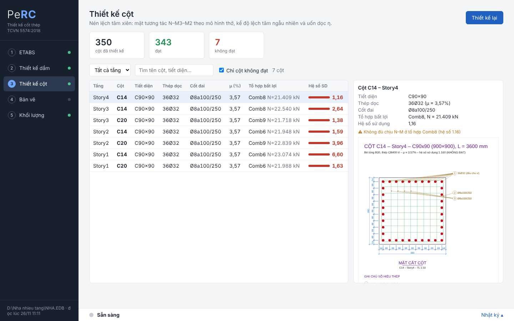
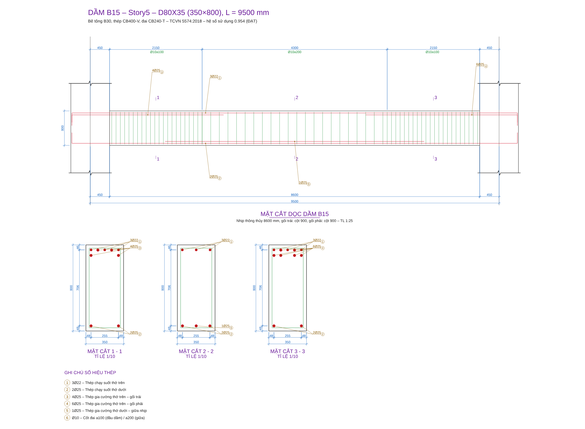
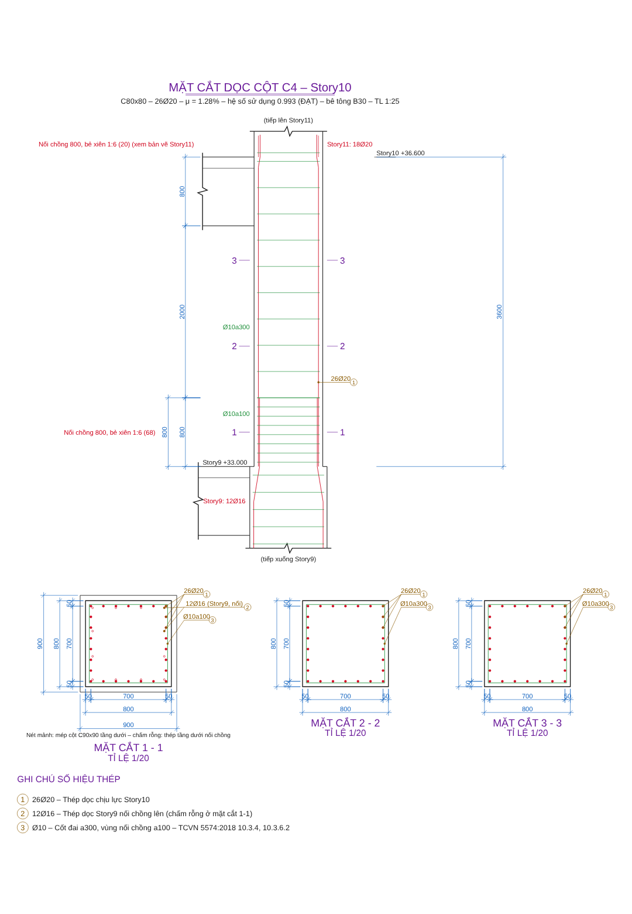
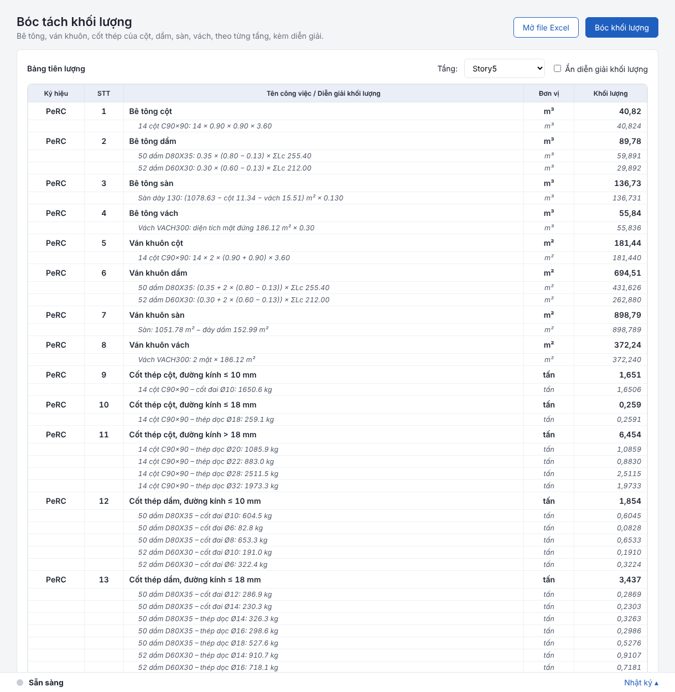
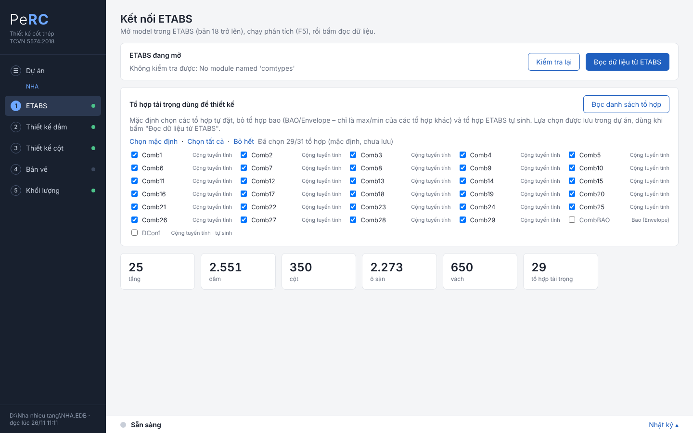

# PeRC – Thiết kế cốt thép theo TCVN 5574:2018, kết nối ETABS

**PeRC** là phần mềm chạy trên Windows, viết bằng Python, có giao diện dạng web nhưng được đóng gói thành ứng dụng. PeRC đọc trực tiếp model ETABS, sau đó:

- thiết kế cốt thép dầm và cột theo **TCVN 5574:2018**,
- xuất bản vẽ mặt cắt (DXF, mở bằng AutoCAD),
- bóc tách khối lượng bê tông, ván khuôn và cốt thép cho toàn công trình.

> Đồ án môn **Lập trình ứng dụng trong xây dựng**.



## Tính năng

| Bước | Chức năng |
|---|---|
| **Dự án** | Mỗi dự án lưu toàn bộ kết quả. Mở lại là xem được ngay, không phải chạy lại. Hỗ trợ tạo, đổi tên, nhân bản và xoá dự án. |
| **1. ETABS** | Tự kết nối ETABS 18 trở lên. Đọc tầng, vật liệu, tiết diện, dầm, cột, sàn, vách và nội lực. Người dùng chọn tổ hợp tải trọng ngay trong app; mặc định bỏ tổ hợp bao và tổ hợp ETABS tự sinh. |
| **2. Dầm** | Tính uốn theo 8.1.2 và cắt theo 8.1.3. Bố trí thép theo 3 vùng (gối trái, giữa nhịp, gối phải), tối đa 2 lớp. Cốt đai theo 10.3.4. |
| **3. Cột** | Nén lệch tâm xiên: dựng mặt tương tác N–M3–M2 bằng mô hình thớ, kể độ lệch tâm ngẫu nhiên và uốn dọc η. Cốt đai theo 10.3.4 và 10.3.6.2. |
| **4. Bản vẽ** | Dầm: mặt cắt dọc kèm 3 mặt cắt ngang. Cột: mặt cắt dọc từng tầng (nối chồng, bẻ xiên 1:6, nút khung theo 10.4.11) kèm 3 mặt cắt ngang. Có đủ kích thước và ký hiệu thép. Xuất DXF R2018. |
| **5. Khối lượng** | Bảng tiên lượng kiểu Eta, xem theo tầng, có diễn giải khối lượng. Xuất Excel có ô chọn tầng. |

<table>
<tr><td></td><td></td></tr>
<tr><td align="center">Mặt cắt dọc và mặt cắt ngang dầm</td><td align="center">Mặt cắt dọc cột một tầng và 3 mặt cắt ngang</td></tr>
<tr><td></td><td></td></tr>
<tr><td align="center">Bảng tiên lượng theo tầng</td><td align="center">Chọn tổ hợp tải trọng</td></tr>
</table>

## Yêu cầu

- Windows 10/11, **ETABS 18 trở lên** (model đã chạy phân tích)
- Python 3.12 (64-bit)

## Cài đặt và chạy

```
git clone https://github.com/nganthuylien-max/PeRC.git
cd PeRC
python -m venv .venv
.venv\Scripts\Activate.ps1
pip install -r requirements.txt
python run_app.py
```

### Quy trình dùng
1. Vào **Dự án** và tạo dự án mới.
2. Mở ETABS, chạy phân tích (F5). Trong app, vào **1. ETABS**, bấm *Đọc danh sách tổ hợp*, chọn tổ hợp, rồi bấm *Đọc dữ liệu từ ETABS*.
3. Vào **2. Dầm** và **3. Cột**, bấm *Thiết kế lại*. Bấm vào từng cấu kiện để xem bản vẽ.
4. Vào **4. Bản vẽ** để xuất DXF theo tầng hoặc mặt cắt dọc cột.
5. Vào **5. Khối lượng**, bấm *Bóc khối lượng*, chọn tầng để xem, rồi *Mở file Excel*.

Mỗi bước cũng chạy được bằng dòng lệnh, trong thư mục của dự án:
`export_json.py`, `design_beams.py`, `design_columns.py`, `draw_sections.py`, `quantity_takeoff.py`.

## Cấu trúc mã nguồn

```
etabs_link/   Kết nối ETABS qua COM API (comtypes): đọc bảng dữ liệu, nội lực
core/         Tính toán TCVN 5574:2018
  materials.py        Vật liệu bê tông, thép
  beam_flexure.py     Dầm chịu uốn (8.1.2)
  beam_shear.py       Dầm chịu cắt (8.1.3), chọn cốt đai (10.3.4)
  beam_layout.py      Bố trí thép dầm, 2 lớp
  beam_design.py      Thiết kế dầm (lặp tới khi đạt)
  beam_detailing.py   Cấu tạo dầm: neo, cắt thép, đai theo vùng
  column_section.py   Mô hình thớ, mặt tương tác N–M3–M2 (NumPy)
  column_design.py    Thiết kế cột, cốt đai (10.3.4, 10.3.6.2)
drawing/      Bản vẽ: mô hình hình học -> SVG (xem trong app) và DXF (ezdxf)
quantity/     Bóc khối lượng, bảng tiên lượng, xuất Excel (openpyxl)
app/          Giao diện: Flask (máy chủ cục bộ) + HTML/JS, quản lý dự án
run_app.py    Khởi động app (cửa sổ pywebview)
```

## Giả thiết và giới hạn

- Thép dọc CB400-V, thép đai CB240-T. Cấp bê tông lấy theo tên vật liệu (B30…); nếu tên không có cấp B thì suy từ fc' của ETABS.
- Chỉ thiết kế cấu kiện **bê tông tiết diện chữ nhật**. Các tiết diện khác được bỏ qua và ghi vào nhật ký.
- Mômen dầm lấy tại tim gối (chưa trừ vùng cứng đầu dầm).
- Chưa xét yêu cầu cấu tạo kháng chấn của TCVN 9386.
- Thép sàn và vách trong bảng khối lượng dùng lưới mặc định (sàn Ø10a200, vách Ø14/Ø10a200, 2 lớp).

## Tác giả

Nguyễn Trần Ngân – môn Lập trình ứng dụng trong xây dựng, 2026.
